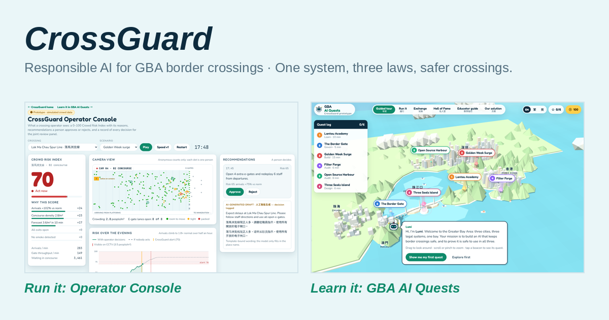
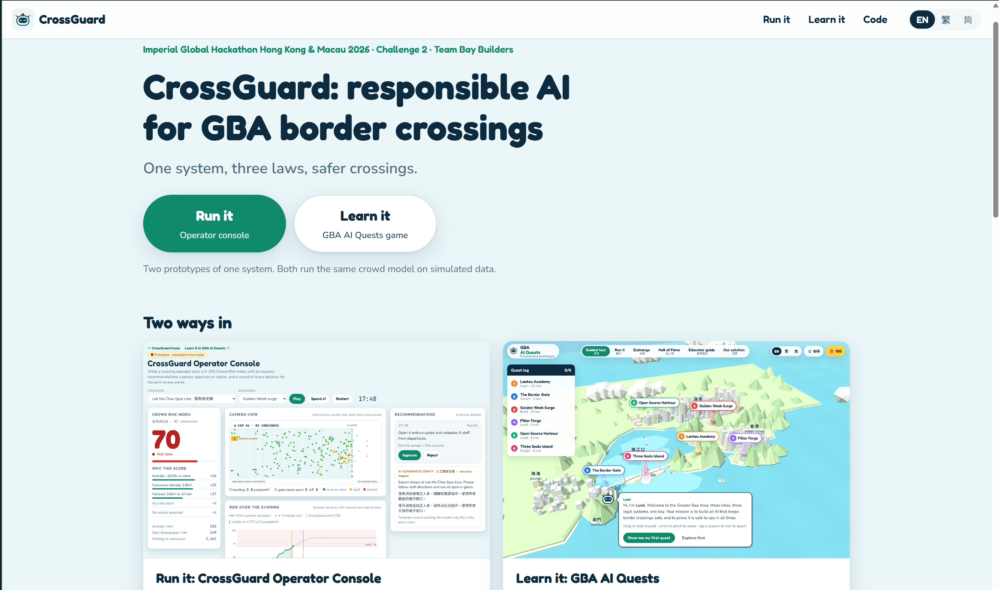

# CrossGuard: responsible AI for GBA border crossings

**One system, three laws, safer crossings.** Two prototypes of one system, built by Team Bay Builders for the Imperial Global Hackathon Hong Kong & Macau 2026, Challenge 2: Responsible AI.

| | Live link |
| --- | --- |
| Landing page | https://jackyzhijie.github.io/crossguard-gba-ai-quests/ |
| Run it: CrossGuard Operator Console | https://jackyzhijie.github.io/crossguard-gba-ai-quests/console/ |
| Learn it: GBA AI Quests | https://jackyzhijie.github.io/crossguard-gba-ai-quests/quests/ |


## Landing page



| | Run it: Operator Console | Learn it: GBA AI Quests |
| --- | --- | --- |
| Who it is for | The operator on duty | Operators, students and the public |
| What you do | Watch an anonymous crowd at Lok Ma Chau, West Kowloon or the HZMB port; read the 0–100 Crowd Risk Index and its reasons; approve or reject each recommendation | Build CrossGuard yourself on a 3D map of the bay, practise comply once, certify three times, and tune a live privacy filter |
| Governance you can see | Data boundary, a fire-mode request blocked by design, spoofed-sensor check, audit log for the joint review panel | Testing that sends you back to fix your data, certification by all three jurisdictions |
| Code | `site/console/` | `src/` |

Both prototypes run the same crowd model: the console imports `src/data/crossguard.ts` from the game, so the two always compute the same Crowd Risk Index.

## What is real and what is simulated

Both prototypes run on simulated crowd data. The Crowd Risk Index is a transparent weighted score of five factors (`src/data/crossguard.ts`). Every score starts at 6 points; the alert is at 70.

| Factor | Up to | Counts fully when |
| --- | ---: | --- |
| Crowd density | 36 | 4 people per m² (starts above 0.6) |
| Arrivals against normal | 24 | 1.65× the normal rate (starts above 0.95×) |
| 10-minute forecast | 20 | 4 people per m² forecast (starts above 1.2) |
| Smoke detected | 16 | A smoke detector is active |
| Exits closed | 14 | Exits are closed by smoke |

Density counts fully at 4 people per m², the UK Green Guide limit for holding areas. The other weights are our assumptions, to be fitted to real data in a pilot. Legal summaries are simplified for teaching, not legal advice. Brand names are illustrative.

## Team Bay Builders

| Member | Affiliation | Role |
| --- | --- | --- |
| Jacky | CityU MPhil (Computer Science) | MVP: prototypes and engineering |
| Billy | PolyU MSc (Building Services Engineering) | Core idea and crowd-risk model |
| Winston | HKU MSc (Electrical & Electronic Engineering) | System architecture and pilot plan |
| Thomas | HKU MSc (Energy Engineering) | Legal harmonisation and governance |
| Christy | PolyU MSc (Electrical Engineering) | Problem framing and AI literacy |

## Repository structure

```
site/index.html, site/main.ts   landing page (/), trilingual, plain TypeScript
site/console/                   operator console (/console/), plain TypeScript
site/public/                    icons and screenshots for the landing page
src/                            GBA AI Quests game (/quests/), React + three.js
src/data/crossguard.ts          the crowd model both prototypes use
src/theme.css                   colours, fonts and shadows shared by all three pages
scripts/assemble.mjs            assembles the game page into dist/quests/
docs/                           technical manual (PDF), screenshot, deck images
```

## Run locally

```bash
npm install
npm run dev        # the game, with hot reload
npm run dev:site   # the landing page and console, with hot reload
npm run build      # type-check, then build dist/ (landing, console/, quests/)
npm run deploy     # build and publish dist/ to the gh-pages branch
```

Pushing to `main` also builds and publishes the site through `.github/workflows/deploy.yml`. Everything is static: no backend, no accounts, and progress stays in the browser.

---

# GBA AI Quests (the game)

## What it is

CrossGuard is a proposal for designing, building, auditing and governing AI that has to work across three legal systems at once: Hong Kong (PDPO), Macau (PDPA) and the mainland (PIPL). Its core is an explainable crowd-risk system for border crossings. Cameras become anonymous counts on site, each side trains locally and shares only model parameters, and a trained operator approves every recommendation.

GBA AI Quests turns each part of the proposal into a quest on a 3D map:

| Quest | Place | What you do |
| --- | --- | --- |
| Lantau Academy | Lantau | Pass short courses on AI literacy, data law, prompt safety and model audits |
| The Border Gate | Macau Border Gate | Allow, redact, block or escalate 12 cross-border AI cases against the clock |
| Golden Week Surge | Lok Ma Chau | Build CrossGuard through the full AI lifecycle, from data search to deployment |
| Filter Forge | Cyberport | Tune a live filter for personal data and prompt injection; find the openness–security sweet spot |
| Open Source Harbour | Qianhai | Share a project and get scored on maturity, risk tier and seven trust dimensions |
| Three Seals Island | HZMB | Comply once, certify three times: turn the strictest rule into one common control |

Points from quests, courses and open-source projects unlock gated rewards such as API credits, compute and incubation. A guided tour walks through the proposal, and an educator guide turns it into a 55-minute lesson. The whole interface switches between **English, Traditional Chinese and Simplified Chinese**.

## Documentation

The **[Technical Manual (PDF)](docs/GBA-AI-Quests-Technical-Manual.pdf)** covers every quest and hub, the scoring rules, the models and formulas, the language layer, privacy, build and testing, and how to extend the game.

## Note

This is a prototype. Crowd data, audits, organisations, leaderboard entries and pilot figures are simulated or illustrative. Brand names show the kind of reward proposed, not confirmed partnerships, and the legal summaries are simplified for teaching, not legal advice.
