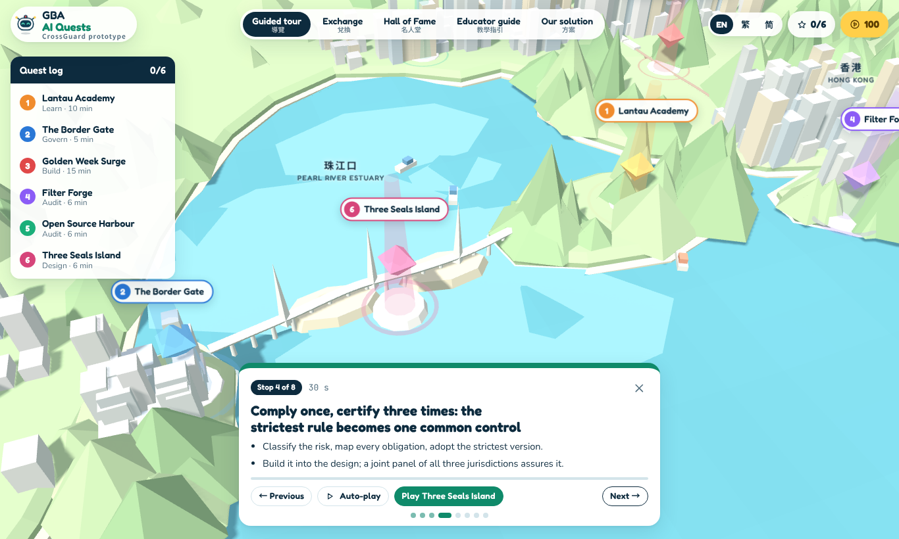

# GBA AI Quests

**A trilingual 3D quest game and working prototype of CrossGuard: responsible AI for cross-border deployment in the Greater Bay Area.**

**▶ Live demo: https://jackyzhijie.github.io/crossguard-gba-ai-quests/**



## What it is

CrossGuard is a proposal for designing, building, auditing and governing AI that has to work across three legal systems at once: Hong Kong (PDPO), Macau (PDPA) and the mainland (PIPL). Its core is an explainable crowd-risk system for border crossings. Cameras become anonymous counts on site, each side trains locally and shares only model parameters, and a trained operator approves every recommendation.

GBA AI Quests turns each part of the proposal into a quest on a 3D map:

| Quest | Place | What you do |
| --- | --- | --- |
| Lantau Academy | Lantau | Pass short courses on AI literacy, data law, prompt safety and model audits |
| The Border Gate | Macau Border Gate | Allow, redact, block or escalate 12 cross-border AI cases against the clock |
| Golden Week Surge | Lok Ma Chau | Build CrossGuard through the full AI lifecycle, from data search to deployment |
| Filter Forge | Cyberport | Tune a live filter for personal data and prompt injection; find the openness–security sweet spot |
| Open Source Harbour | Qianhai | Share a project and get scored on maturity, risk tier and seven trust dimensions |
| Three Seals Island | HZMB | Comply once, certify three times: turn the strictest rule into one common control |

Points from quests, courses and open-source projects unlock gated rewards such as API credits, compute and incubation. A guided tour walks through the proposal, and an educator guide turns it into a 55-minute lesson. The whole interface switches between **English, Traditional Chinese and Simplified Chinese**.

## Run locally

```bash
npm install
npm run dev        # dev server with hot reload
npm run build      # type-check, build with Vite, and assemble the page in dist/
```

Built with TypeScript, React 18, three.js and Vite. There is no backend: progress stays in the browser's local storage.

**Deployment.** Every push to `main` runs `.github/workflows/deploy.yml`: GitHub Actions installs dependencies, builds the TypeScript source and publishes `dist/` to the `gh-pages` branch, which GitHub Pages serves.

## Project structure

```
src/App.tsx        shell: 3D stage, quest log, hubs, guided tour, routing
src/world/         procedural three.js map of the Greater Bay Area
src/quests/        Golden Week Surge and Three Seals Island
src/pages/         Border Gate, Academy, Filter Forge, Harbour, Exchange, Hall of Fame, Educator guide
src/data/          content and models: filter engine, crowd-risk model, Trust Score, rewards
src/i18n/          language layer and generated EN / 繁 / 简 dictionaries
i18n-tools/        translation tables and the generator script
docs/              technical manual (PDF) and screenshot
.github/workflows/ build-and-deploy workflow for GitHub Pages
```

## Documentation

The **[Technical Manual (PDF)](docs/GBA-AI-Quests-Technical-Manual.pdf)** covers every quest and hub, the scoring rules, the models and formulas, the language layer, privacy, build and testing, and how to extend the game.

## Note

This is a prototype. Crowd data, audits, organisations, leaderboard entries and pilot figures are simulated or illustrative. Brand names show the kind of reward proposed, not confirmed partnerships, and the legal summaries are simplified for teaching, not legal advice.
